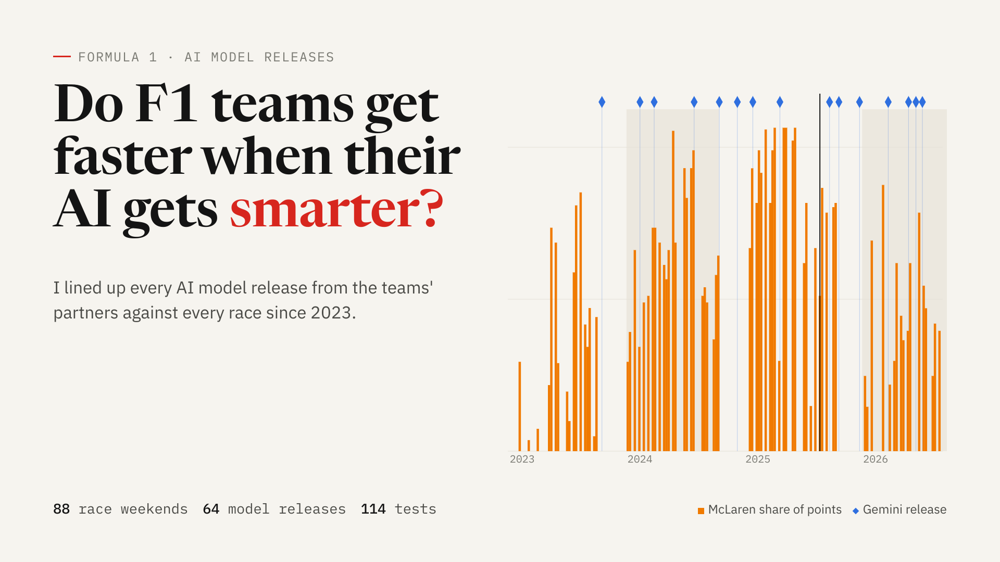
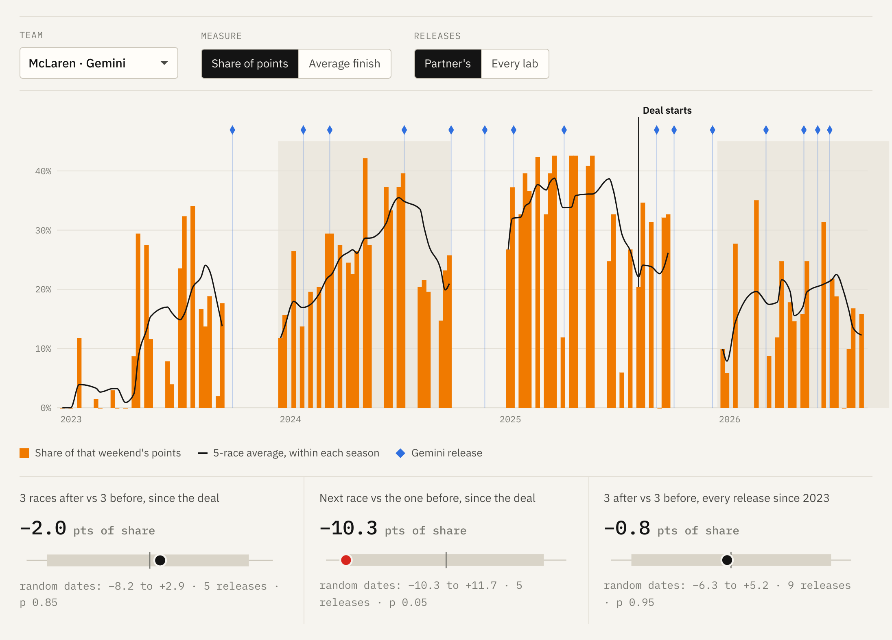
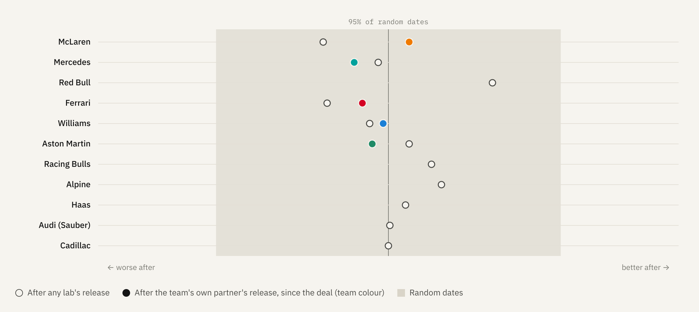
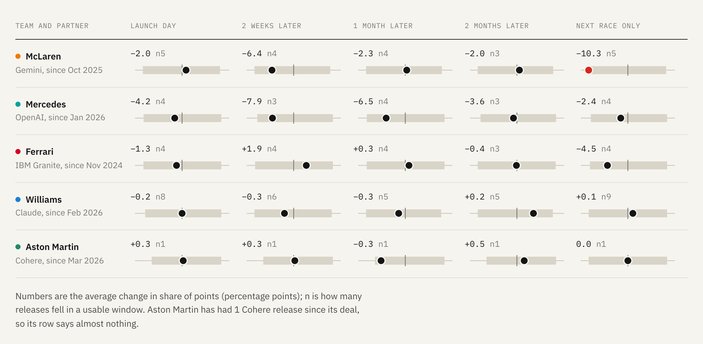

<p align="center">
  
</p>

<h1 align="center">Do F1 teams get faster when their AI gets smarter?</h1>

<p align="center">
  <a href="https://f1-ai-releases.vercel.app"><b>Open the interactive page →</b></a>
  <br>
  <sub>88 race weekends · 11 teams · 64 AI model releases · 114 statistical tests</sub>
</p>

---

## Why this exists

Formula 1 teams now sign AI partners the way they sign oil and tyre suppliers. McLaren works with Google's Gemini, Williams with Anthropic's Claude, Aston Martin with Cohere, Mercedes with Microsoft. The press releases talk about faster engineering, better strategy calls and smarter simulation.

So here's a fair question to put to the data: **when a team's AI partner ships a better model, does the team go faster on track?** And when a lab admits its model got worse for a few weeks, does the team slip?

This project lines up every model release from those partners against every Grand Prix and sprint since 2023 and checks.

## The short answer

**No.** A team's results after its AI partner ships a new model look the same as its results after any random date. That holds for every team, for both measures (share of points and average finishing place), and when you assume teams get new models two weeks, a month or two months late.

Out of 114 tests, one came in under p 0.05, about what luck alone would produce (you'd expect around six). It was McLaren scoring a *smaller* share of points the race right after a Gemini release. After correcting for running that many tests, nothing comes close.

That's not a knock on AI in F1. It says a model launch isn't a lever you can see in race results a week later. The cars are designed and built months ahead, the deals are mostly brand new, and upgrades, rules, tracks and drivers move results far more.

## What the page shows

| | |
|---|---|
|  | **Pick a team.** Each bar is one race weekend: the team's share of all points scored. The diamonds are their AI partner's model releases, and the black line is when the deal started. Under the chart, each test is shown as a dot (what happened) on a grey bar (where 95% of random dates land). |
|  | **All eleven teams.** Every team's change after releases, scaled so the grey band is the range random dates produce. If AI releases helped, the dots would lean right and out of the band. They don't. |
|  | **What if teams get models late?** Big companies don't switch on launch day, so the test is rerun with 2-week, 1-month and 2-month delays, plus a next-race-only version. |

The page also covers the three times a lab publicly confirmed its model got worse, who partners with whom (with each team's own announcement), and the full method.

## How it works

1. **Race results.** Every Grand Prix and sprint from Bahrain 2023 to the 2026 United States GP, from the open [F1DB](https://github.com/f1db/f1db) dataset. Every team's season points total was checked against the official [formula1.com standings](https://www.formula1.com/en/results/2026/team) for 2023 to 2026, and all 40 matched.
2. **Two measures.** *Share of points*: the team's race plus sprint points as a percentage of everything scored that weekend, so sprint weekends don't look like good weekends. *Average finish*: the mean classified place of both cars, with a retirement counted as last.
3. **Model releases.** 64 releases from Google, OpenAI, Anthropic, Cohere and IBM, each dated from the lab's own announcement or API changelog. The full list, with a source link for every date, is in [`data/model-releases.json`](data/model-releases.json).
4. **The test.** For each release: the average of the 3 races after minus the 3 races before, with all six races inside one season so a new car never sits on one side. That's compared with 20,000 random sets of race gaps for the same team, which gives the grey range and a p-value.
5. **Many tests, so corrected.** 114 tests in all, with a Benjamini-Hochberg correction for multiple comparisons. Every result is in [`data/tests.csv`](data/tests.csv).

### Who works with whom

| Team | AI partner | Since | Engineering use? | Source |
|---|---|---|---|---|
| McLaren | Google (Gemini) | Oct 2025 | Yes | [McLaren](https://www.mclaren.com/racing/formula-1/2025/mclaren-racing-announces-partnership-extension-with-google/) |
| Mercedes | Microsoft (Azure AI) | Jan 2026 | Yes | [Microsoft](https://news.microsoft.com/source/2026/01/22/microsoft-and-mercedes-amg-petronas-f1-team-unite-to-drive-innovation-from-factory-to-circuit/) |
| Red Bull | Oracle (OCI) | 2022 | Yes | [Oracle](https://www.oracle.com/news/announcement/oracle-red-bull-racing-extends-title-partnership-with-oracle-2026-02-26/) |
| Williams | Anthropic (Claude) | Feb 2026 | Yes | [Williams](https://www.williamsf1.com/articles/0f1eece4-e632-49c9-a767-148159bbbf87/anthropic-atlassian-williams-f1-team-multi-year-partnership-claude-official-thinking-partner) |
| Aston Martin | Cohere | Mar 2026 | Yes | [Cohere](https://cohere.com/blog/cohere-aston-martin-formula-one-generative-ai-partner) |
| Racing Bulls | Neural Concept | Jun 2025 | Yes | [Business Wire](https://www.businesswire.com/news/home/20250603836415/zh-CN) |
| Ferrari | IBM (watsonx) | Nov 2024 | Fan app and analytics | [IBM](https://newsroom.ibm.com/2024-11-07-ibm-selected-as-official-fan-engagement-and-data-analytics-partner-for-scuderia-ferrari-hp) |
| Haas | Mphasis | Nov 2024 | IT and analytics | [Haas](https://haasf1team.com/news/moneygram-haas-f1-team-welcomes-mphasis-partnership) |
| Alpine | Indra Group | Jan 2026 | Not described | [Indra](https://www.indragroup.com/en/news/indra-group-makes-an-impact-at-mobile-world-congress-with-bwt-alpine-formula-onetm-team-car-and-its-sovereign-ai-proposal-for-highly-complex-competitive-environments) |
| Audi | ElevenLabs | Jan 2026 | No (voice, fan content) | [Audi F1](https://contenthub.audif1.com/en/releases/elevenlabs-named-official-partner-of-audi-revolut-f1-team-97) |
| Cadillac | TWG AI | Feb 2026 | Not described | [Cadillac F1](https://www.cadillacf1team.com/news/twg-ai-joins-the-cadillac-formula-1-r-team-as-primary-and-exclusive-ai) |

No team says which model version it runs. Microsoft doesn't say which models Mercedes uses, so Mercedes is paired with OpenAI's releases (the flagship models on Azure) as an inference. Red Bull, Racing Bulls and the others don't have a public model line, so they're tested against every lab's releases.

### What this can't tell you

- Launch dates stand in for the day a team actually got the model. Nobody publishes their switch-over date.
- Most deals are months old, so most teams have seen only a handful of releases. A small real effect could hide in this much noise. A large one would have shown up.
- "Got worse" events are only the ones a lab confirmed publicly with dates. There are three, which is too few to test.

## Run it yourself

Needs Python 3 with PyYAML.

```bash
python3 scripts/fetch_f1db.py raw            # download the 88 races from F1DB
python3 scripts/analyze.py raw analysis.json # run every test
python3 scripts/pagedata.py analysis.json > pagedata.json
python3 scripts/build.py src/page.html pagedata.json . https://github.com/richardbernard2026/F1-AI-releases- https://f1-ai-releases.vercel.app
```

## What's in here

```
index.html                  the live page (built, self-contained)
src/page.html               page source with a data placeholder
data/model-releases.json    every model release and setback, with a source link each
data/results.csv            per race, per team: points, share of points, average finish
data/tests.csv              every test: change, random range, p-value, corrected q-value
data/f1db-races.txt         the 88 F1DB race folders used
scripts/                    fetch, analyse, build
docs/                       images for this README and the LinkedIn cover
```

## Credits

Race data from [F1DB](https://github.com/f1db/f1db), an open Formula 1 database. Charts built with [D3](https://d3js.org). Model release dates from each lab's own announcements and changelogs.

Built by Richard Bernard with Claude. Not affiliated with Formula 1, any team or any AI lab.
